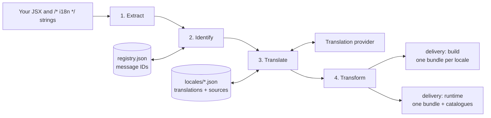
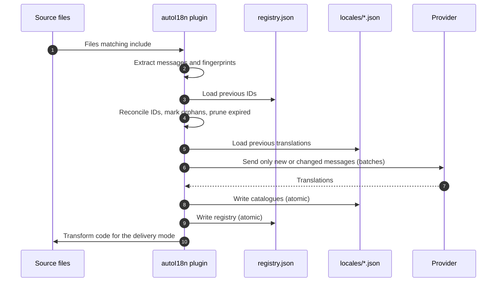
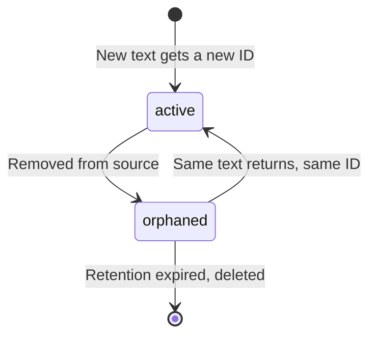
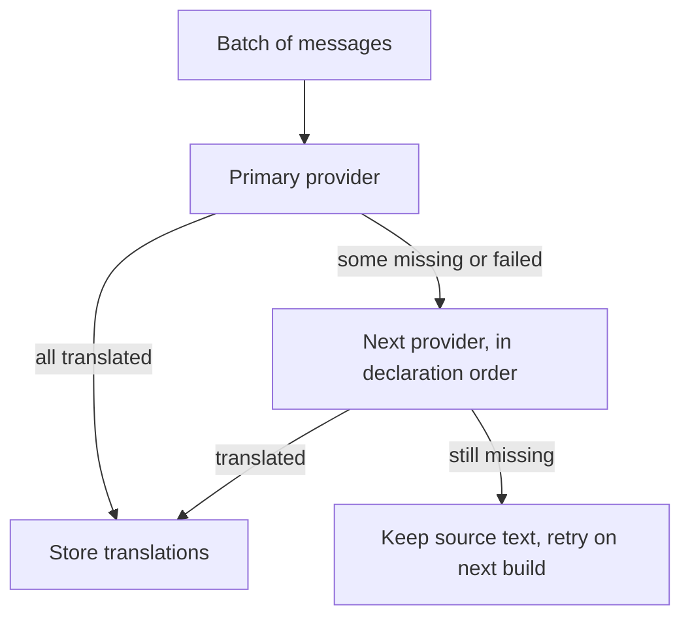
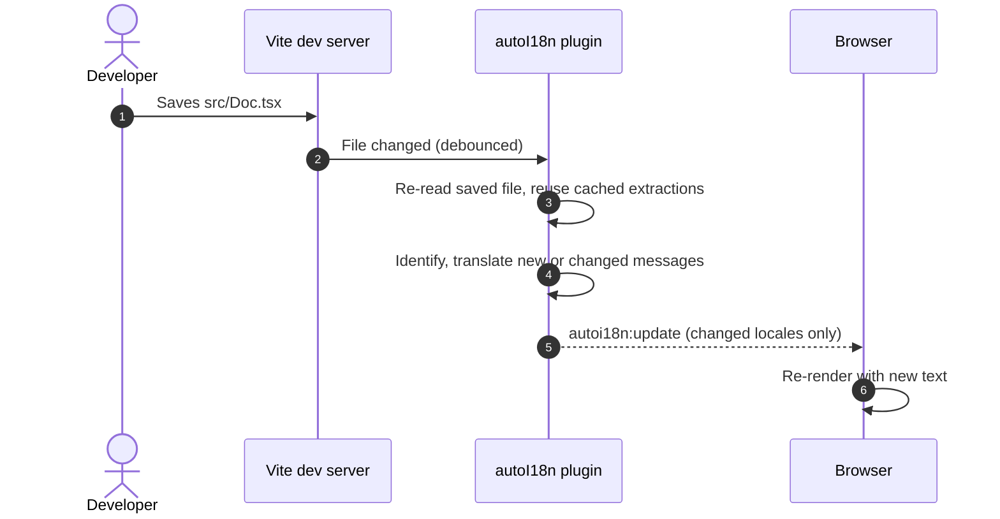
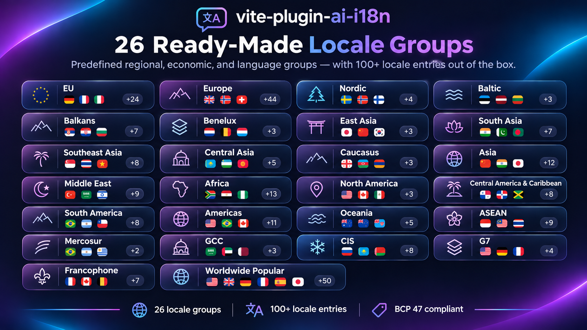
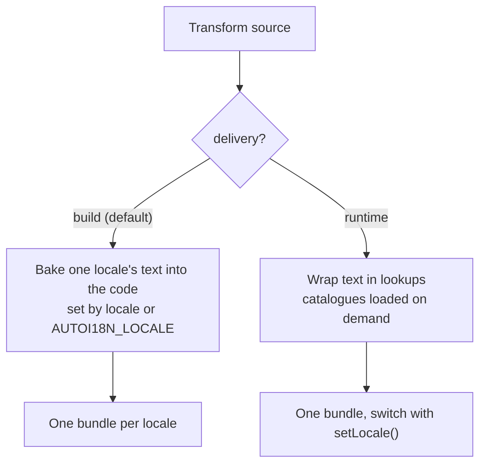

# 🌍 vite-plugin-ai-auto-i18n

**Build-time localization for JSX.** Write English directly. The compiler extracts user-facing copy, gives each message a stable ID, and can translate it with an AI or machine-translation provider.

> [!WARNING]
> **Beta.** Configuration options and `.autoi18n/` file formats are meant to stay stable, but review the [known limitations](#-known-limitations) before shipping to production. Pin the version while in beta.


## 📑 Contents

- [✨ Features](#-features)
- [📍 Overview](#-overview)
- [🔄 How it works](#-how-it-works)
- [📦 Installation](#-installation)
- [📚 Examples](#-examples)
- [🚚 Delivery modes](#-delivery-modes)
- [🔧 Configuration](#-configuration)
- [🔌 Providers](#-providers)
- [🔒 Reliability](#-reliability)
- [🧹 Maintenance](#-maintenance)
- [🧪 Test coverage](#-test-coverage)
- [🚧 Known limitations](#-known-limitations)
- [🧭 Design rules](#-design-rules)

## ✨ Features

**Extraction**

- JSX text nodes and static string attributes
- String literals outside JSX, but only when marked with a comment such as `/* i18n */`

**Identity**

- Opaque, persistent message IDs stored in `.autoi18n/registry.json`
- Moving or renaming files and components does not change IDs
- Removed messages are kept as orphans for 30 days, so their IDs can come back

**Translation**

- Pluggable providers: Anthropic, Gemini, any OpenAI-compatible API (OpenAI, Mistral, Groq, Ollama and [many more](#choosing-a-provider)), DeepL and Google Translate
- Only new or changed messages are sent to the provider
- Source English is always the fallback

**Delivery**

- `build`: one compiled bundle per locale
- `runtime`: one bundle, with locales loaded on demand

## 📍 Overview



Every build, and every save in the dev server, runs the same four phases. The next section follows one component through them.

## 🔄 How it works

### Build at a glance



The examples below follow one component through the phases. IDs are shortened for readability; real IDs look like `msg_6f5e12bdbc7a4804`.

### Phase 0: the source you write

```tsx
// src/Doc.tsx
export function Doc({ count }: { count: number }) {
  return (
    <section>
      <button title="Save the current document">Save</button>
      <p>You have {count} documents</p>
    </section>
  );
}
```

### Phase 1: extract

The compiler parses each file in `include` and records every translatable string with its kind, tag, component and a fingerprint. Nothing is written yet.

```jsonc
[
  {
    "source": "Save the current document",
    "kind": "attribute",
    "tag": "button",
    "attribute": "title",
    "component": "Doc",
    "context": "button | title | title=Save the current document",
  },
  {
    "source": "Save",
    "kind": "text",
    "tag": "button",
    "component": "Doc",
    "context": "button | title=Save the current document",
  },
  {
    "source": "You have {count} documents",
    "kind": "mixed",
    "placeholders": ["count"],
    "tag": "p",
    "component": "Doc",
    "context": "p",
  },
]
```

- Mixed sentences are ICU MessageFormat messages. Simple expressions become named arguments (`{count}`), and translators can use ICU syntax such as plurals and selects.
- Literal `'`, `{` and `}` in the text are escaped (`Don''t`).

### Phase 2: identify

Each extracted message is matched against `.autoi18n/registry.json`:

- A match keeps the existing ID.
- A new message gets a new opaque ID.
- A message that disappears is marked `orphaned`, not deleted, so its ID can come back.

```jsonc
// .autoi18n/registry.json (excerpt)
{
  "version": 1,
  "entries": {
    "msg_a1": {
      "id": "msg_a1",
      "source": "Save the current document",
      "kind": "attribute",
      "tag": "button",
      "component": "Doc",
      "attribute": "title",
      "fingerprint": "58365c073009b7b7b2aa27b1",
      "location": "src/Doc.tsx:4",
      "status": "active",
      "firstSeen": "2026-11-02T17:28:36.128Z",
      "lastSeen": "2026-11-14T14:54:42.201Z",
    },
  },
}
```

Component names and file paths are not part of the fingerprint, so moving or renaming a file does not change the ID.

#### Message lifecycle



A deleted message that returns later gets a new ID and is translated again.

### Phase 3: translate

Only new or changed messages (source text changed since the last build) are sent to the provider. Results are stored in `.autoi18n/locales/<locale>.json`, next to the source text each translation was made from.

```jsonc
// .autoi18n/locales/de.json
{
  "messages": {
    "msg_a1": "Dokument speichern",
    "msg_a2": "Speichern",
    "msg_a3": "Du hast {count} Dokumente",
  },
  "sources": {
    "msg_a1": "Save the current document",
    "msg_a2": "Save",
    "msg_a3": "You have {count} documents",
  },
}
```

- Translations never overwrite an existing entry silently.
- If the source text changes, the stored `sources` entry no longer matches, so the message is translated again.

#### Provider fallback



Fallback runs per batch. See [Multiple providers and fallback](#multiple-providers-and-fallback).

### Phase 4: transform

The source is rewritten according to `delivery`.

**`delivery: "build"`** bakes the German text into the code, and the `t()` call disappears:

```diff
 export function Doc({ count }: { count: number }) {
   return (
     <section>
-      <button title="Save the current document">Save</button>
-      <p>You have {count} documents</p>
+      <button title="Dokument speichern">{"Speichern"}</button>
+      <p>{__autoI18nFormat("Du hast {count} Dokumente", {"count": count}, "de")}</p>
     </section>
   );
 }
```

**`delivery: "runtime"`** replaces each string with a lookup. The source text stays in the code as the fallback:

```diff
+import { t as __autoI18nT, getLocale as __autoI18nLocale } from "virtual:autoi18n";
+import { format as __autoI18nFormat } from "virtual:autoi18n-format";
 export function Doc({ count }: { count: number }) {
   return (
     <section>
-      <button title="Save the current document">Save</button>
-      <p>You have {count} documents</p>
+      <button title={__autoI18nT("msg_a1", "Save the current document")}>{__autoI18nT("msg_a2", "Save")}</button>
+      <p>{__autoI18nFormat(__autoI18nT("msg_a3", "You have {count} documents"), {"count": count}, __autoI18nLocale())}</p>
     </section>
   );
 }
```

If a locale has no translation for an ID, the source text is shown. Nothing breaks while translations are missing.

### 🔥 Dev server

Saving a file re-reads only that file, reuses the cached extraction for the rest of the project, and pushes only the catalogues that changed to the browser, so the page updates without a reload.



Locales that did not change are not sent. Adding or removing a file runs a full project scan instead, debounced by 150 ms.

## 📦 Installation

### 1️⃣ Install the package

In your React + Vite project:

```sh
npm install -D vite-plugin-ai-auto-i18n
```

Equivalent commands: `bun add -D`, `pnpm add -D`, or `yarn add -D`, with the same package name.

- Requires **Vite 8+** (peer dependency) and **Node.js 26+**.
- For React, also keep `@vitejs/plugin-react` in your Vite config.

### 2️⃣ Add your API key


Put the key in `.env.local` and keep that file out of git:

| Provider                            | Variable                                        |
| ----------------------------------- | ----------------------------------------------- |
| OpenAI or any OpenAI-compatible API | `OPENAI_API_KEY`                                |
| Anthropic (Claude)                  | `ANTHROPIC_API_KEY`                             |
| Gemini                              | `GEMINI_API_KEY`                                |
| Other services                      | See [Choosing a provider](#choosing-a-provider) |

### 3️⃣ Configure Vite

Add the plugin to `vite.config.ts`. `loadEnv` reads `.env.local` for the config file:

```ts
import react from "@vitejs/plugin-react";
import { defineConfig, loadEnv } from "vite";
import autoI18n, { AnthropicProvider, OpenAICompatibleProvider } from "vite-plugin-ai-auto-i18n";

export default defineConfig(({ mode }) => {
  const env = loadEnv(mode, process.cwd(), "");

  return {
    plugins: [
      autoI18n({
        locales: ["en", "de", "fr"],
        sourceLocale: "en",
        provider: {
          primary: "anthropic",
          anthropic: new AnthropicProvider({
            apiKey: env.ANTHROPIC_API_KEY!,
            model: "claude-haiku-5-5",
          }),
          openai: new OpenAICompatibleProvider({
            apiKey: env.OPENAI_API_KEY!,
            model: "gpt-4.1-mini",
          }),
        },
      }),
      react(), // in runtime delivery, keep autoI18n before the React plugin
    ],
  };
});
```

### 4️⃣ Commit the generated files

The build writes `.autoi18n/` (registry and catalogues). Commit it so existing translations are reused instead of requested again. ✅

Then write ordinary JSX:

```tsx
<button title="Save the current document">Save</button>
```

### 🧪 Try the bundled example

The `example/` folder contains a React document dashboard:

```sh
bun install
bun run example:dev     # dev server
bun run example:build   # production build into example/dist
```

Each locale file has two parts: `messages` (the translations) and `sources` (the source text each translation was made from).

## 📚 Examples

### Minimal build with one locale per CI job

Set `locale` or the `AUTOI18N_LOCALE` variable. Only that locale is translated and compiled:

```ts
// vite.config.ts
autoI18n({
  locales: ["en", "de", "fr"],
  locale: process.env.AUTOI18N_LOCALE, // undefined = all locales
  provider: new OpenAICompatibleProvider({ apiKey: process.env.OPENAI_API_KEY!, model: "gpt-4.1-mini" }),
  failOnMissingProvider: true,
});
```

```yaml
# .github/workflows/build.yml (excerpt)
strategy:
  matrix:
    locale: [en, de, fr]
steps:
  - run: AUTOI18N_LOCALE=${{ matrix.locale }} npx vite build --outDir dist/${{ matrix.locale }}
```

### Runtime delivery with a locale switcher

```ts
// vite.config.ts
(autoI18n({ locales: ["en", "de", "fr"], delivery: "runtime" }), // no provider: source text is shown until translations exist
  react()); // keep autoI18n before the React plugin
```

```tsx
// src/LocaleSwitcher.tsx
import { useSyncExternalStore } from "react";
import { getLocale, getVersion, locales, setLocale, subscribe } from "virtual:autoi18n";

export function LocaleSwitcher() {
  // Re-render when the locale or any catalogue changes
  useSyncExternalStore(subscribe, getVersion, getVersion);
  return (
    <select value={getLocale()} onChange={(e) => setLocale(e.target.value)}>
      {locales.map((code) => (
        <option key={code} value={code} translate="no">
          {code}
        </option>
      ))}
    </select>
  );
}
```

### Locale groups in practice



Groups from the `locales` export replace long lists of codes. Spread them into `locales`, and add any extra codes next to them:

```ts
// vite.config.ts
import autoI18n, { locales } from "vite-plugin-ai-auto-i18n";

// A European product: all EU languages plus the major non-EU ones
autoI18n({ locales: [...locales.EUROPE] });

// A global app: Asia and the Americas (AMERICAS already includes English)
autoI18n({ locales: [...locales.ASIA, ...locales.AMERICAS] });

// A Nordic site that also ships Estonian
autoI18n({ locales: [...locales.NORDIC, "et"] });
```

The `locales` export from `virtual:autoi18n` (runtime delivery) is a different thing: it lists the codes this build ships, so it reflects whichever array you passed to the plugin.

### Keeping copy untranslated

```tsx
<h2 translate="no">Sample code</h2>
<code title="Product SKU">SKU-1042</code>
```

`translate="no"` also covers the element's descendants and attributes.

### Translating strings outside JSX

Put a block comment directly before the literal:

```tsx
export function Items() {
  const items = [{ label: /* i18n */ "Shared with your team" }, { label: "Private" }];
  return (
    <ul>
      {items.map((i) => (
        <li key={i.label}>{i.label}</li>
      ))}
    </ul>
  );
}
```

Only `"Shared with your team"` is translated. `"Private"` has no marker and stays English.

> [!NOTE]
> In runtime delivery, the lookup runs when the expression is evaluated. Keep marked strings inside a component or function, not at module level, so the active locale is known at render time.

### Custom marker and custom components

```ts
autoI18n({
  locales: ["en", "de"],
  stringMarker: "t", // write /* t */ "Save" instead
  componentProps: {
    Button: ["aria-label", "title", "children"], // <Button>Save</Button> is translated
    Tooltip: ["content"],
  },
});
```

With this config, `<Button title="Delete">Delete {count} files</Button>` extracts both the attribute and the text as a placeholder message.

### Writing your own provider

Any object with a `translate` method works:

```ts
import type { TranslationProvider } from "vite-plugin-ai-auto-i18n";

const deepl: TranslationProvider = {
  async translate({ sourceLocale, targetLocale, messages }) {
    const out: Record<string, string> = {};
    for (const m of messages) {
      // Keep ICU arguments such as {count} intact; the plugin rejects translations that change them or are not valid ICU.
      out[m.id] = await callYourService(m.source, targetLocale);
    }
    return out;
  },
};
```

Return only the IDs you translated. Throw `PartialTranslationError` to keep a partial result.

## 🚚 Delivery modes



|                                      | `build` (default)                             | `runtime`                      |
| ------------------------------------ | --------------------------------------------- | ------------------------------ |
| Bundles                              | One per locale                                | One for all locales            |
| Locale chosen                        | At build time (`locale` or `AUTOI18N_LOCALE`) | In the browser (`setLocale()`) |
| Only the chosen locale is translated | Yes, when a locale is set explicitly          | No, all configured locales     |
| Unknown locale                       | Fails the build                               | —                              |

### Build delivery

Use `AUTOI18N_LOCALE=de vite build` (on Windows, `cross-env AUTOI18N_LOCALE=de vite build`) or `locale: "de"` in the plugin options, typically in a CI build matrix. When a locale is set explicitly, only that locale is translated during the build. Without one, all configured locales are translated. An unknown locale fails the build.

### Runtime delivery

Text is wrapped in `t(id, source)` calls and catalogues are fetched on demand. Import the API from the virtual module:

```ts
import { getLocale, locales, resolveSupported, setLocale, subscribe, t } from "virtual:autoi18n";

setLocale(resolveSupported(navigator.languages)); // call before first render
```

- `createLocaleLoader` and `resolveLocale` are available from the `vite-plugin-ai-auto-i18n/runtime` subpath, not the main entry.
- `subscribe(listener)` returns an unsubscribe function.
- `getVersion()` changes whenever the locale or the catalogues change, so `useSyncExternalStore(subscribe, getVersion, getVersion)` re-renders components that read `t()` during render.
- Components wrapped in `memo` must subscribe themselves, or they keep the old text until their props change.
- List `autoI18n()` **before** `@vitejs/plugin-react` in `plugins`. The React plugin rewrites JSX in dev before other pre-transforms run, so the plugin must see the original JSX.
- Add a type declaration for `virtual:autoi18n` (see [example/src/autoi18n-virtual.d.ts](/home/bogdan/git/vite-plugin-ai-i18n/example/src/autoi18n-virtual.d.ts)). The example app uses this mode with a locale switcher.

## 🔧 Configuration

### Plugin options (`autoI18n({...})`)

| Option                   | Type                                                                            | Default                                 | Description                                                                                                                                          |
| ------------------------ | ------------------------------------------------------------------------------- | --------------------------------------- | ---------------------------------------------------------------------------------------------------------------------------------------------------- |
| `locales`                | `string[]`                                                                      | _required_                              | Locales the app ships, for example `["en", "de", "fr"]`. The source locale is never translated, so including it is harmless.                         |
| `sourceLocale`           | `string`                                                                        | `"en"`                                  | Language the JSX is written in. Used as the fallback when a translation is missing.                                                                  |
| `delivery`               | `"build" \| "runtime"`                                                          | `"build"`                               | `build` compiles one locale per build. `runtime` ships every catalogue and switches locale in the browser with `setLocale()`.                        |
| `locale`                 | `string`                                                                        | `sourceLocale`                          | Locale to compile in `build` delivery. Also read from `AUTOI18N_LOCALE`; the option wins when both are set.                                          |
| `include`                | `string[]`                                                                      | `["src/**/*.{tsx,jsx,ts,js}"]`          | Glob patterns of source files to scan, relative to the Vite root.                                                                                    |
| `exclude`                | `string[]`                                                                      | `["**/*.test.*", "**/node_modules/**"]` | Glob patterns of files to skip, relative to the Vite root.                                                                                           |
| `directory`              | `string`                                                                        | `".autoi18n"`                           | Folder for `registry.json` and `locales/`, relative to the Vite root.                                                                                |
| `provider`               | `TranslationProvider \| { primary?, [name]: TranslationProvider \| undefined }` | `undefined`                             | Translates missing and changed messages. One provider, or named providers with a `primary`. Without one, untranslated messages show the source text. |
| `failOnMissingProvider`  | `boolean`                                                                       | `false`                                 | When `true`, the build fails if a locale has untranslated messages and no `provider` is set.                                                         |
| `onAmbiguous`            | `"warn" \| "error"`                                                             | `"warn"`                                | What to do when duplicated identical texts change their occurrence count, so their IDs may have moved. `"error"` fails the build.                    |
| `orphanRetentionMinutes` | `number`                                                                        | `43200` (30 days)                       | Minutes an orphaned message is kept before deletion. `0` deletes on the next build; `Infinity` keeps forever.                                        |
| `localeConcurrency`      | `number`                                                                        | `2`                                     | Locales translated at the same time. Values below 1 are raised to 1, and fractions are rounded down.                                                 |
| `debug`                  | `boolean`                                                                       | `false`                                 | Logs each message sent to the provider, each translation received, and each removed orphan, with timestamps.                                         |
| `componentProps`         | `Record<string, string[]>`                                                      | `{}`                                    | Attributes of custom components whose string values are UI copy, for example `{ Button: ["aria-label", "title"] }`. See below.                       |
| `stringMarker`           | `string`                                                                        | `"i18n"`                                | Text of the block comment that marks a string literal outside JSX, for example `/* i18n */ "Save"`. Set it to `"t"` for `/* t */ "Save"`.            |

**`componentProps`** tells the plugin which props of custom components hold UI copy. The pseudo-prop `children` makes text children translatable, including sentences with `{name}` expressions. Only the listed attributes are extracted from those components.

```ts
componentProps: {
  Button: ["children", "aria-label"];
}
// extracts <Button>Save</Button> and <Button>Delete {count} files</Button>
```

<details>
<summary><strong>Locale groups</strong>: ready-made lists for the <code>locales</code> option</summary>

The package exports a `locales` object with ready-made locale lists. Each group is a plain array of BCP 47 codes. Spread a group so the shared object stays unchanged:

```ts
import autoI18n, { locales } from "vite-plugin-ai-auto-i18n";

autoI18n({ locales: [...locales.EUROPE] });
autoI18n({ locales: ["en", ...locales.ASIA] });
```

| Group                       | Languages                                                                                                             |
| --------------------------- | --------------------------------------------------------------------------------------------------------------------- |
| `EU`                        | 23 official EU languages                                                                                              |
| `EUROPE`                    | `EU` plus Norwegian, Icelandic, Albanian, Bosnian, Macedonian, Serbian, Ukrainian, Russian, Belarusian, Catalan       |
| `NORDIC`                    | Danish, Finnish, Icelandic, Norwegian, Swedish                                                                        |
| `BALTIC`                    | Estonian, Latvian, Lithuanian                                                                                         |
| `BALKANS`                   | Albanian, Bosnian, Bulgarian, Croatian, Greek, Macedonian, Romanian, Serbian, Slovenian                               |
| `BENELUX`                   | Dutch, French, Luxembourgish                                                                                          |
| `EAST_ASIA`                 | Chinese, Japanese, Korean, Mongolian                                                                                  |
| `SOUTH_ASIA`                | Hindi, Bengali, Urdu, Punjabi, Tamil, Telugu, Marathi, Gujarati, Kannada, Malayalam, Nepali, Sinhala                  |
| `SOUTHEAST_ASIA`            | Indonesian, Malay, Burmese, Khmer, Lao, Filipino, Thai, Vietnamese                                                    |
| `CENTRAL_ASIA`              | Kazakh, Kyrgyz, Tajik, Turkmen, Uzbek                                                                                 |
| `CAUCASUS`                  | Armenian, Azerbaijani, Georgian                                                                                       |
| `ASIA`                      | `EAST_ASIA`, `SOUTH_ASIA`, `SOUTHEAST_ASIA`, `CENTRAL_ASIA`, `CAUCASUS`                                               |
| `MIDDLE_EAST`               | Arabic, Persian, Hebrew, Turkish, Kurdish                                                                             |
| `AFRICA`                    | Arabic, French, Portuguese, Swahili, Amharic, Hausa, Yoruba, Igbo, Zulu, Xhosa, Afrikaans, Somali, Kinyarwanda, Wolof |
| `NORTH_AMERICA`             | English, French, Spanish                                                                                              |
| `CENTRAL_AMERICA_CARIBBEAN` | Spanish, English, French, Haitian Creole, Dutch                                                                       |
| `SOUTH_AMERICA`             | Spanish, Portuguese, Quechua, Guarani, Aymara                                                                         |
| `AMERICAS`                  | `NORTH_AMERICA`, `CENTRAL_AMERICA_CARIBBEAN`, `SOUTH_AMERICA`                                                         |
| `OCEANIA`                   | English, Maori, Samoan, Tongan                                                                                        |
| `ASEAN`                     | `SOUTHEAST_ASIA` languages plus English (working language)                                                            |
| `MERCOSUR`                  | Spanish, Portuguese, Guarani                                                                                          |
| `GCC`                       | Arabic, English                                                                                                       |
| `CIS`                       | Russian, Belarusian, Armenian, Azerbaijani, Kazakh, Kyrgyz, Tajik, Uzbek                                              |
| `G7`                        | English, French, German, Italian, Japanese                                                                            |
| `FRANCOPHONE`               | French, Haitian Creole, Wolof, Lingala, Kinyarwanda                                                                   |
| `WORLDWIDE_POPULAR`         | The 17 languages with the most speakers worldwide, including English, Chinese, Hindi, Spanish, and Arabic             |

</details>

## 🔌 Providers

### Choosing a provider

Every service is either a native API (Anthropic, Gemini), or speaks the OpenAI Chat Completions protocol and is used through `OpenAICompatibleProvider` with a different `baseURL`. The library reads no environment variables itself; the key names below are what the example config uses.

<details>
<summary><strong>All supported services</strong> (key variable, base URL, example model)</summary>

| Service                                  | Class                      | Key variable          | Base URL                                           | Example default model                               |
| ---------------------------------------- | -------------------------- | --------------------- | -------------------------------------------------- | --------------------------------------------------- |
| Anthropic (Claude)                       | `AnthropicProvider`        | `ANTHROPIC_API_KEY`   | `https://api.anthropic.com/v1`                     | `claude-haiku-5-5`                                  |
| Gemini                                   | `GeminiProvider`           | `GEMINI_API_KEY`      | `https://generativelanguage.googleapis.com/v1beta` | `gemini-3.5-flash-lite`                             |
| OpenAI                                   | `OpenAICompatibleProvider` | `OPENAI_API_KEY`      | `https://api.openai.com/v1` (default)              | `gpt-4.1-mini`                                      |
| Mistral                                  | `OpenAICompatibleProvider` | `MISTRAL_API_KEY`     | `https://api.mistral.ai/v1`                        | `mistral-small-latest`                              |
| Groq                                     | `OpenAICompatibleProvider` | `GROQ_API_KEY`        | `https://api.groq.com/openai/v1`                   | `llama-3.3-70b-versatile`                           |
| DeepSeek                                 | `OpenAICompatibleProvider` | `DEEPSEEK_API_KEY`    | `https://api.deepseek.com/v1`                      | `deepseek-chat`                                     |
| OpenRouter                               | `OpenAICompatibleProvider` | `OPENROUTER_API_KEY`  | `https://openrouter.ai/api/v1`                     | `openai/gpt-4.1-mini`                               |
| xAI                                      | `OpenAICompatibleProvider` | `XAI_API_KEY`         | `https://api.x.ai/v1`                              | `grok-3-mini`                                       |
| Cerebras                                 | `OpenAICompatibleProvider` | `CEREBRAS_API_KEY`    | `https://api.cerebras.ai/v1`                       | `llama-3.3-70b`                                     |
| Perplexity                               | `OpenAICompatibleProvider` | `PERPLEXITY_API_KEY`  | `https://api.perplexity.ai`                        | `sonar`                                             |
| Together AI                              | `OpenAICompatibleProvider` | `TOGETHER_API_KEY`    | `https://api.together.xyz/v1`                      | `meta-llama/Llama-3.3-70B-Instruct-Turbo`           |
| Fireworks AI                             | `OpenAICompatibleProvider` | `FIREWORKS_API_KEY`   | `https://api.fireworks.ai/inference/v1`            | `accounts/fireworks/models/llama-v3p3-70b-instruct` |
| Hugging Face                             | `OpenAICompatibleProvider` | `HUGGINGFACE_API_KEY` | `https://router.huggingface.co/v1`                 | `meta-llama/Llama-3.3-70B-Instruct`                 |
| DeepInfra                                | `OpenAICompatibleProvider` | `DEEPINFRA_API_KEY`   | `https://api.deepinfra.com/v1/openai`              | `meta-llama/Meta-Llama-3.1-70B-Instruct`            |
| SambaNova                                | `OpenAICompatibleProvider` | `SAMBANOVA_API_KEY`   | `https://api.sambanova.ai/v1`                      | `Meta-Llama-3.3-70B-Instruct`                       |
| Moonshot (Kimi)                          | `OpenAICompatibleProvider` | `MOONSHOT_API_KEY`    | `https://api.moonshot.ai/v1`                       | `moonshot-v1-8k`                                    |
| Ollama (local, no key)                   | `OpenAICompatibleProvider` | none                  | `http://localhost:11434/v1`                        | none, you must set one                              |
| LM Studio (local, no key)                | `OpenAICompatibleProvider` | none                  | `http://localhost:1234/v1`                         | none, you must set one                              |
| llama.cpp `llama-server` (local, no key) | `OpenAICompatibleProvider` | none                  | `http://localhost:8080/v1`                         | none, you must set one                              |
| vLLM (local, no key)                     | `OpenAICompatibleProvider` | none                  | `http://localhost:8000/v1`                         | none, you must set one                              |
| LocalAI (local, no key)                  | `OpenAICompatibleProvider` | none                  | `http://localhost:8080/v1`                         | none, you must set one                              |
| Docker Model Runner (local, no key)      | `OpenAICompatibleProvider` | none                  | `http://localhost:12434/engines/v1`                | none, you must set one                              |

</details>

- **Model names change often.** The defaults are examples; set `model` to any name the service currently offers.
- **Hosted services** are enabled in the example config only when their key variable is set. `<NAME>_MODEL` also overrides the default model (for example `MISTRAL_MODEL`).
- **Local runtimes** have no key. They are enabled by `<NAME>_MODEL` (the model you have loaded, for example `OLLAMA_MODEL` or `LMSTUDIO_MODEL`), with `<NAME>_BASE_URL` to override the server address (for example `LLAMACPP_BASE_URL`).
- **Keyless servers:** omit `apiKey`. The `Authorization` header is then not sent.
- **Use a model that reliably returns JSON.** Small local models often do not. Malformed replies are retried, then left untranslated.
- The Mistral, Groq, DeepSeek, OpenRouter, xAI, Cerebras, Ollama and other services added after them were checked against their documentation and with stubbed HTTP responses only, not against live services. Local runtimes default to their standard ports, which can differ per install.

```ts
new OpenAICompatibleProvider({
  apiKey: env.GROQ_API_KEY!,
  baseURL: "https://api.groq.com/openai/v1",
  model: "llama-3.3-70b-versatile",
});
new OpenAICompatibleProvider({ baseURL: "http://localhost:11434/v1", model: "qwen2.5:7b" }); // Ollama, no key
```

### Built-in provider options

All three model providers send messages in batches, run requests in parallel, time out, and retry. Create them with `new OpenAICompatibleProvider(options)`, `new AnthropicProvider(options)` or `new GeminiProvider(options)`.

**Shared by all three:**

| Option         | Default    | Description                                                                        |
| -------------- | ---------- | ---------------------------------------------------------------------------------- |
| `model`        | _required_ | Model name sent in each request.                                                   |
| `batchSize`    | `40`       | Messages per request. Smaller batches keep responses within output limits.         |
| `concurrency`  | `4`        | Batches sent in parallel across all locales of this provider instance.             |
| `timeoutMs`    | `60000`    | Milliseconds before a single request is aborted.                                   |
| `maxRetries`   | `2`        | Extra attempts for network errors, timeouts, 408/409/429/5xx and malformed output. |
| `retryDelayMs` | `500`      | Delay before the first retry. It doubles on each attempt.                          |

**`OpenAICompatibleProvider`** calls `${baseURL}/chat/completions`.

| Option    | Default                       | Description                                                                                                    |
| --------- | ----------------------------- | -------------------------------------------------------------------------------------------------------------- |
| `apiKey`  | _optional_                    | Bearer token. Omit for servers that need no key, such as a local Ollama. Read it from an environment variable. |
| `baseURL` | `"https://api.openai.com/v1"` | Base URL of any OpenAI-compatible API.                                                                         |

**`AnthropicProvider`** calls the [Anthropic Messages API](https://docs.anthropic.com/en/api/messages) at `${baseURL}/messages`.

| Option      | Default                          | Description                                                                                 |
| ----------- | -------------------------------- | ------------------------------------------------------------------------------------------- |
| `apiKey`    | _required_                       | Anthropic API key, sent as `x-api-key`. Read it from an environment variable.               |
| `baseURL`   | `"https://api.anthropic.com/v1"` | Base URL of the Messages API.                                                               |
| `maxTokens` | `8192`                           | Maximum tokens the model may generate per batch. Lower it only if your model limits output. |

**`GeminiProvider`** calls the [Gemini `generateContent` endpoint](https://ai.google.dev/api/generate-content) at `${baseURL}/models/${model}:generateContent` in JSON output mode.

| Option            | Default                                              | Description                                                                                 |
| ----------------- | ---------------------------------------------------- | ------------------------------------------------------------------------------------------- |
| `apiKey`          | _required_                                           | Gemini API key, sent as `x-goog-api-key`. Read it from an environment variable.             |
| `baseURL`         | `"https://generativelanguage.googleapis.com/v1beta"` | Base URL of the Gemini API.                                                                 |
| `maxOutputTokens` | `8192`                                               | Maximum tokens the model may generate per batch. Lower it only if your model limits output. |

Example: `new GeminiProvider({ apiKey: env.GEMINI_API_KEY!, model: "gemini-3.5-flash-lite" })`.

### Machine-translation providers

DeepL and Google Translate return translations directly rather than model output, so they skip the JSON prompt. Each adapter protects `{name}` placeholders from the engine and restores them afterwards. Batching, concurrency and retry options match the other providers.

- **`DeepLProvider({ apiKey, baseURL? })`**: `POST /v2/translate` with `Authorization: DeepL-Auth-Key`.
  - Keys ending in `:fx` use `https://api-free.deepl.com`; all others use `https://api.deepl.com`.
  - Plain `en` and `pt` targets map to `EN-US` and `PT-BR`, because DeepL rejects the unqualified codes as targets.
  - Set `DEEPL_API_KEY`.
- **`GoogleTranslateProvider({ apiKey, baseURL? })`**: Cloud Translation v2 (Basic) in HTML mode, sent as `x-goog-api-key`.
  - Placeholders are wrapped in `<span translate="no">`. Google's Advanced (v3) API is not used.
  - Set `GOOGLE_TRANSLATE_API_KEY`.

> [!NOTE]
> Placeholder protection covers simple `{name}` arguments only. Complex ICU `plural` and `select` blocks are not protected, so check those translations in the output.

### Helpers for named provider maps

Instead of writing `env.X ? new Provider(...) : undefined` for each service, use the helpers exported from the package. Each returns `undefined` when its credentials are missing, so the entry is skipped. They take values, not environment names, so the library still reads no environment variables.

| Helper                                    | Enum                                            | Enabled by                   | Returns                                                              |
| ----------------------------------------- | ----------------------------------------------- | ---------------------------- | -------------------------------------------------------------------- |
| `hosted(HostedService.X, apiKey, model?)` | `HostedService` (Anthropic and Gemini included) | `apiKey`                     | `AnthropicProvider`, `GeminiProvider`, or `OpenAICompatibleProvider` |
| `local(LocalService.X, model, baseURL?)`  | `LocalService`                                  | `model` (you have loaded it) | `OpenAICompatibleProvider`                                           |
| `machine(MachineService.X, apiKey)`       | `MachineService` (`DeepL`, `Google`)            | `apiKey`                     | `DeepLProvider` or `GoogleTranslateProvider`                         |

```ts
import autoI18n, {
  hosted,
  HostedService,
  local,
  LocalService,
  machine,
  MachineService,
} from "vite-plugin-ai-auto-i18n";

autoI18n({
  provider: {
    primary: env.PRIMARY_PROVIDER || undefined,
    mistral: hosted(HostedService.Mistral, env.MISTRAL_API_KEY, env.MISTRAL_MODEL),
    ollama: local(LocalService.Ollama, env.OLLAMA_MODEL, env.OLLAMA_BASE_URL),
    anthropic: hosted(HostedService.Anthropic, env.ANTHROPIC_API_KEY, env.ANTHROPIC_MODEL),
    deepl: machine(MachineService.DeepL, env.DEEPL_API_KEY),
  },
});
```

The `model` and `baseURL` arguments override the defaults. Passing `undefined` keeps the default.

### Multiple providers and fallback

Pass `provider` as an object with one entry per provider.

- **`primary`** names the provider tried first. It is never inferred: set it yourself, or leave it out to try providers in declaration order.
- Entries set to `undefined` are skipped, so you can keep every provider in the config and enable each one by its key.

```ts
provider: {
  primary: "anthropic",
  anthropic: env.ANTHROPIC_API_KEY ? new AnthropicProvider({ apiKey: env.ANTHROPIC_API_KEY, model: "claude-haiku-5-5" }) : undefined,
  openai: env.OPENAI_API_KEY ? new OpenAICompatibleProvider({ apiKey: env.OPENAI_API_KEY, model: "gpt-4.1-mini" }) : undefined,
  gemini: env.GEMINI_API_KEY ? new GeminiProvider({ apiKey: env.GEMINI_API_KEY, model: "gemini-3.5-flash-lite" }) : undefined
}
```

**How fallback works**

- If the primary fails (for example a bad key, an outage, or rate limits that survive the retries), the messages it did not translate go to the next configured provider, in declaration order.
- Fallback happens per batch. A partial result keeps the translations that came back, and only the missing messages move on.
- The build logs a warning each time it falls back.
- If every provider fails, the locale keeps its previous file, as with a single provider.
- Naming a `primary` that is not configured fails the build with a clear error.
- Passing a single provider instance (`provider: new AnthropicProvider(...)`) still works and needs no map.

### Custom providers

Any object with this shape can be passed as `provider`:

```ts
interface TranslationProvider {
  translate(input: {
    sourceLocale: string;
    targetLocale: string;
    messages: TranslationRequest[];
  }): Promise<Record<string, string>>; // message ID -> translated text
}

interface TranslationRequest {
  id: string; // opaque ID to echo back in the result
  source: string; // English text
  context: string; // for example "Toolbar > Save button"
  kind: "text" | "attribute" | "mixed" | "string"; // text node, static attribute, JSX with expressions, or a marked string literal
  placeholders?: string[]; // ICU argument names (for example "count") that must survive translation
}
```

- Return only the IDs you translated. Omitted IDs stay in the source language and are requested again on the next build.
- To keep partial results, throw `PartialTranslationError` (exported from the package) with the translations you have and the number of failed messages.
- Any other error fails the whole locale, which keeps its previous file.

## 🔒 Reliability

- **Batching and retries.** Built-in providers send messages in batches (`batchSize`, default 40), run up to `concurrency` batches at once (default 4), abort after `timeoutMs` (default 60000), and retry up to `maxRetries` times (default 2) with exponential backoff from `retryDelayMs` (default 500). Other 4xx errors fail immediately.
- **Limited parallelism.** The plugin translates up to `localeConcurrency` locales at once (default 2). The provider's `concurrency` is shared by all locales, so at most `concurrency` batches are in flight per provider instance, not `localeConcurrency × concurrency`. Lower `concurrency` if your provider rate-limits your account.
- **Missing messages.** If a provider omits some messages, the rest are kept. The missing ones stay in the source language until the next build retries them, and the build logs how many were left untranslated.
- **Failed batches.** If a batch fails, the other batches are still stored, and the failed messages fall back to the source text until the next build. If every batch for a locale fails, that locale keeps its previous file, and the build reports the error after writing the other locales.
- **Missing provider.** With `failOnMissingProvider: true`, the build fails when a locale is missing translations and no provider is configured, instead of silently shipping English.
- **Ambiguous matches.** Duplicate identical strings whose count changed are logged as warnings. Set `onAmbiguous: "error"` to fail the build instead. When a message is paired by fingerprint, the component name breaks ties between identical strings, so reordering or renaming components keeps existing IDs.
- **Privacy in logs.** Provider errors report only the HTTP status (for example `Translation API failed (500)`). The response body is discarded so provider output is not written to logs.
- **Incremental writes.** In dev, saving an indexed source file re-reads only that file and reuses cached extractions for the rest of the project. Adding or removing a file runs a full scan. Catalogue and registry files are written only when their content actually changes.
- **Safe files.** Writes are atomic, so an interrupted build does not leave a truncated file. Corrupt `registry.json` or catalogue files are renamed to `<file>.corrupt-<timestamp>` with a warning, and the plugin continues with an empty state.

## 🧹 Maintenance

### Orphans and retention

Messages removed from the source are kept as orphans in `registry.json`, so their IDs can be reused if the text returns. Orphans not seen for `orphanRetentionMinutes` (default `43200`, i.e. 30 days) are deleted on the next build, and the build logs how many were removed. Use `0` to delete them immediately or `Infinity` to keep them forever. Once deleted, a returning message gets a new ID and is translated again.

### Prune CLI

Prunes orphans without running a build.

```sh
bun run prune                                  # example app, --retention-minutes 0
bun run prune -- --directory .autoi18n --retention-minutes 1440 --debug
```

| Option                | Default           | Description                                                        |
| --------------------- | ----------------- | ------------------------------------------------------------------ |
| `--directory`         | `.autoi18n`       | Relative to the current directory.                                 |
| `--retention-minutes` | `43200` (30 days) | Same meaning as the plugin option.                                 |
| `--debug`             | off               | Prints each removed entry with its source text and last-seen time. |

- In this repository, `bun run prune` builds and then runs the CLI on `example/.autoi18n/` with `--retention-minutes 0`, so every orphan is removed.
- The CLI also removes any key from the `messages` and `sources` maps of `locales/*.json` that is no longer an active registry entry, so the catalogues match the registry.
- If no registry exists at that path, the CLI says so and changes nothing.
- Installed packages can run `node node_modules/vite-plugin-ai-auto-i18n/dist/cli/prune.js` with the same options.

### Stats CLI

Reports translation statistics without running a build.

```sh
bun run stats                                                    # example app
bun run stats -- --directory .autoi18n --source-locale en --verbose
```

| Option            | Default     | Description                                              |
| ----------------- | ----------- | -------------------------------------------------------- |
| `--directory`     | `.autoi18n` | Folder to read.                                          |
| `--source-locale` | `en`        | Excluded from the figures.                               |
| `--verbose`       | off         | Lists the missing, outdated and orphaned IDs per locale. |
| `--json`          | off         | Prints the full report as JSON for CI.                   |

The report shows:

- **Registry counts:** active and orphaned entries, by kind and component.
- **Per locale:** translated count, coverage percentage, **missing** (no translation), **outdated** (translated from a source that has since changed), and **orphaned** keys (what `prune` would remove).
- **Orphaned registry entries.**

Installed packages can run `node node_modules/vite-plugin-ai-auto-i18n/dist/cli/stats.js` with the same options.

### Debugging

Set `debug: true` to print every translation exchange to the console. Each line is prefixed with `[autoi18n debug]` and an ISO timestamp:

- `sent`: each message sent to the provider
- `received`: each translation received back

### Upgrading from an earlier version

The old flat locale files and `*.sources.json` sidecars are not read. Every message is re-translated once on the first build, and the sidecars are deleted.

### 🔑 Provider requirement

Translations need a provider. Without one, untranslated messages show the source text; set `failOnMissingProvider: true` to make that a build error.

## 🧪 Test coverage

Run the suite with coverage (V8 provider, `src/**`):

```bash
bunx vitest run --coverage --coverage.include='src/**' --coverage.reporter=text
```

| Metric     | Coverage          |
| ---------- | ----------------- |
| Statements | 89.4% (1100/1230) |
| Branches   | 82.8% (564/681)   |
| Functions  | 91.1% (246/270)   |
| Lines      | 91.9% (874/951)   |

Per module:

- Plugin hooks (`src/index.ts`): 95.9% statements
- Translation pipeline (`src/translate.ts`) and runtime helpers (`src/runtime/`): 100%
- Prune CLI (`src/cli/prune.ts`): 96.5%
- Stats CLI (`src/cli/stats.ts`): 0%, no tests
- Compiler entity table (`src/compiler/entities.ts`): 28.6%

### Release pipeline

Every push to `main` runs [.github/workflows/release.yml](.github/workflows/release.yml):

1. **Verify.** The `verify` job runs first.
2. **Version bump.** Computed from [conventional commits](https://www.conventionalcommits.org/) since the last `v*` tag: `fix`/`perf` → patch, `feat` → minor, `!` or `BREAKING CHANGE:` → major.
3. **Publish** to npm and create a GitHub Release whose notes list the changes since the previous tag.

Pushes without a releasable commit do nothing. The release commit is `chore(release): vX.Y.Z [skip ci]`.

The `verify` job also produces these artifacts:

- `coverage-summary`: from `bun run test:coverage`, which writes `coverage/coverage-summary.json`.
- `package-pack`: from `npm pack --dry-run --json` after the build.

The GitHub Release notes end with three generated sections:

- **Test coverage:** statements, branches, functions and lines for the released commit.
- **Package:** tarball size, unpacked size, file count, and distribution by location and type.
- **Dependencies:** runtime and peer dependencies from `package.json`. Dependencies are not bundled into `dist/`.

No coverage threshold is enforced and no size limit is checked. A drop in coverage or an increase in package size does not block a release. To check coverage before pushing, run the command in [Test coverage](#-test-coverage) locally.

## 🚧 Known limitations

This is a beta release. Review these before shipping to production:

1. **Runtime loading.** Runtime delivery loads a catalogue per locale. A message's source text is used until its catalogue has loaded.
2. **Mixed sentences.** Sentences with simple expressions (`You have {count} documents`, where `count` is an identifier or member path) are translated as ICU MessageFormat messages and formatted at runtime with `intl-messageformat`.
   - Translations that are not valid ICU, or that change the set of argument names, are rejected.
   - Argument names are sanitized to letters, digits and `_` (`doc.name` becomes `doc_name`). Translations stored under the old `{doc.name}` names fall back to the source until retranslated.
   - Sentences with complex expressions (calls, JSX, computed access) stay entirely in the source language.
3. **Duplicate identical strings.** Occurrences are paired by stable source ordering. This handles ordinary line shifts, but cannot guarantee identity if indistinguishable duplicates are reordered or moved independently. Such cases are reported through `onAmbiguous`, not resolved automatically.
4. **Full scan on add or remove.** Saving a file re-reads only that file. Adding or removing a source file triggers a full project scan (debounced by 150 ms), which may be slow in very large projects.
5. **What gets extracted.**
   - JSX text, and these attributes on intrinsic (lowercase) elements: `alt`, `title`, `placeholder`, `label`, `summary`, `aria-label`, `aria-description`, `aria-placeholder`, `aria-roledescription`, `aria-valuetext`.
   - String literals outside JSX, only when marked with `stringMarker` (`/* i18n */` by default).
   - Text inside capitalised components (for example `<Button>Save</Button>`) only when the component lists `children` in `componentProps`. Their attributes only when listed there too.
   - Other attributes such as `href` are not extracted. Unmarked JS string literals, template literals, Markdown, server-rendered content and rich-text components need explicit policies.
6. **Example setup.** The example uses a React plugin in its Vite config; install `@vitejs/plugin-react` in the consuming example.
7. **Fingerprints are heuristic.** They exclude file and line position, but component names and nearby semantic signals can still change during refactors.

## 🧭 Design rules

- **IDs are opaque and persistent.** Never expose semantic fingerprints as runtime keys.
- **AI never silently overwrites** an existing translation.
- **Source English is always a valid fallback.**
- **Ambiguous matches are surfaced, not guessed.**
- **Translation happens outside the render path.**
